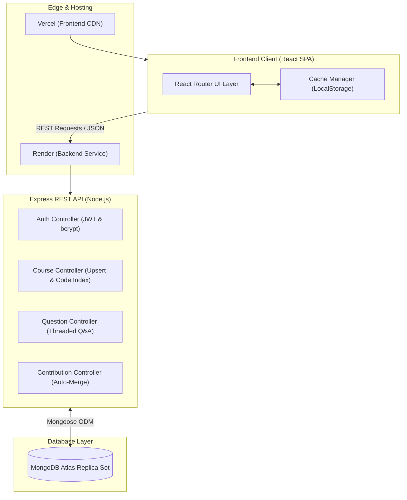

# KGPArkive

[](https://nodejs.org/)
[](https://react.dev/)
[](https://expressjs.com/)
[](https://www.mongodb.com/atlas)
[](https://tailwindcss.com/)
[](LICENSE)

KGPArkive is a centralized academic repository and collaborative community platform engineered for the students of IIT Kharagpur. The platform provides access to curated lecture notes, textbook references, tutorial solution sets, NPTEL playlists, previous years' examination papers (PYQs), and a peer-to-peer academic Q&A exchange.

---

## Table of Contents

- [System Architecture](#system-architecture)
- [Key Features](#key-features)
- [Subject Code & Auto-Update Model](#subject-code--auto-update-model)
- [Performance & Client-Side Caching](#performance--client-side-caching)
- [Project Directory Structure](#project-directory-structure)
- [API Reference](#api-reference)
- [Local Development Setup](#local-development-setup)
- [Database Seeding](#database-seeding)
- [Deployment Guide](#deployment-guide)
- [Contributing](#contributing)

---

## System Architecture

KGPArkive is structured as a full-stack monorepo consisting of an Express/Node.js backend and a React single-page frontend.



### Architectural Highlights
- **Decoupled Architecture**: Independent frontend and backend deployments communicating via RESTful JSON APIs.
- **Fail-Safe Fallbacks**: If the cloud database is temporarily unreachable, the frontend seamlessly degrades to bundled static JSON datasets without crashing.
- **Stale-While-Revalidate Caching**: Eliminates network latency on frequent navigations by populating the view from local storage while refreshing in the background.

---

## Key Features

1. **Course Repository (`/acads`)**:
   - Categorized by academic level: Freshers (1st Year), Semesters (Departmental), and Commons.
   - Real-time client-side search across subject names, course codes, and descriptions.
   - Course listings feature subject code badges with zero latency.

2. **Dedicated Course View (`/acads/:subject`)**:
   - Direct access to Class Notes, NPTEL Lectures, Reference E-Books, Official Tutorials, and MetaKGP PYQ links.
   - Comprehensive **Course Description & Helpful Notes** section embedded directly on the course page.
   - Embedded video carousel with thumbnail generation and direct playback access.

3. **Academic Q&A Forum (`/questions`)**:
   - Community-driven question-and-answer exchange.
   - Categorized into answered and unanswered queues.
   - Threaded replies, expandable answer previews, and pagination.

4. **Resource Contribution Portal (`/contribute`)**:
   - Allows students and teaching assistants to submit Drive folders, lecture slides, and notes.
   - Supports upserting into existing courses via standard IIT KGP subject codes.

---

## Subject Code & Auto-Update Model

To prevent duplicate entries and maintain high data integrity across departments, each course is uniquely identified by an alphanumeric **Subject Code** (e.g., `ET60007`, `CS10001`, `MA20106`).

### Deduplication & Upsert Logic
When a user or contributor submits study materials:
1. The backend inspects the payload for an alphanumeric `code` (normalized to uppercase).
2. If a course with that code exists in MongoDB:
   - Existing resources are preserved.
   - New links (class notes, tutorials, books, video lectures) and descriptions are merged into the existing document.
   - No duplicate course card is created.
3. If no matching course code is found, a lookup by title and category is performed as a fallback before creating a new entry.

---

## Performance & Client-Side Caching

KGPArkive employs an automated client-side prefetch mechanism:

- **Initial Load Prefetch**: On initial visit to any route, `prefetchAllData()` runs asynchronously in `App.js` to pre-load all academic courses and Q&A threads into `localStorage`.
- **Zero-Latency Route Switching**: Navigating between `/`, `/acads`, and `/questions` reads from local storage instantly (0ms rendering).
- **Silent Background Revalidation**: Network requests execute in the background. When updated data arrives from MongoDB Atlas, custom window events dispatch changes and keep the UI in sync without page reloads.

---

## Project Directory Structure

```
KGPArkive/
├── README.md                           # Root project documentation
├── .gitignore                          # Global git ignore configuration
│
├── Backend/                            # Node.js / Express REST API
│   ├── config/
│   │   └── db.js                       # MongoDB Atlas Mongoose connection setup
│   ├── controllers/
│   │   ├── authController.js           # Registration, login, and JWT issuance
│   │   ├── contactController.js        # Nodemailer support inbox integration
│   │   ├── contributionController.js   # Material submission & course auto-merge
│   │   ├── courseController.js         # Course queries, search, and code indexing
│   │   └── questionController.js       # Q&A management and reply threads
│   ├── models/
│   │   ├── Contribution.js             # Contributed material schema
│   │   ├── Course.js                   # Course schema with alphanumeric code index
│   │   ├── Question.js                 # Question and answer schema
│   │   └── User.js                     # User profile and authentication schema
│   ├── routes/                         # Express API route endpoints
│   ├── scripts/
│   │   └── seedCourses.js              # Database seeder with 20+ core KGP courses
│   ├── .env                            # Backend environment configuration
│   ├── package.json                    # Backend dependencies and scripts
│   └── server.js                       # Express application entry point
│
└── Frontend/                           # React SPA Application
    ├── public/
    │   ├── Data/                       # Bundled static JSON fallback datasets
    │   └── index.html                  # HTML entry template
    ├── src/
    │   ├── components/
    │   │   ├── Navbar.js               # Header navigation and authentication states
    │   │   └── Footer.js               # Site footer and resource links
    │   ├── context/
    │   │   └── AuthContext.js          # Authentication and user state provider
    │   ├── Pages/
    │   │   ├── Home.js                 # Landing page
    │   │   ├── Acads.js                # Course archive directory
    │   │   ├── SubPage.js              # Dedicated subject page with helpful notes
    │   │   ├── SubjectPageWrapper.js   # Dynamic route loader with cache lookup
    │   │   ├── Questions.js            # Q&A discussion board
    │   │   ├── SubmitQuestion.js       # Form for posting new queries
    │   │   ├── MyQuestions.js          # User-specific query tracker
    │   │   ├── contri.js               # Material contribution form
    │   │   ├── Contact.js              # Support and feedback contact form
    │   │   ├── Login.js                # Account login
    │   │   └── Register.js             # Account registration
    │   ├── utils/
    │   │   └── cacheManager.js         # LocalStorage caching and prefetch pipeline
    │   ├── App.js                      # Root router and global prefetch initializer
    │   └── index.js                    # React DOM entry point
    ├── .env                            # Frontend local environment config
    ├── .env.production                 # Frontend production environment config
    ├── package.json                    # Frontend dependencies and build scripts
    └── vercel.json                     # Vercel deployment routing rules
```

---

## API Reference

### Courses
| Method | Endpoint | Description |
|:-------|:---------|:------------|
| `GET` | `/api/courses` | Retrieve courses (supports `?category=`, `?search=`, and `?code=`) |
| `GET` | `/api/courses/:id` | Retrieve single course by MongoDB ID, course slug, or Subject Code |
| `POST` | `/api/courses` | Create a new course or auto-update existing course by subject code |

### Questions & Answers
| Method | Endpoint | Description |
|:-------|:---------|:------------|
| `GET` | `/api/questions` | Retrieve all questions sorted by creation date |
| `GET` | `/api/questions/user/:username` | Retrieve questions submitted by a specific user |
| `POST` | `/api/questions` | Create a new academic question |
| `POST` | `/api/questions/:id/answers` | Submit an answer to a question |
| `DELETE` | `/api/questions/:id` | Remove a question by ID |

### Contributions
| Method | Endpoint | Description |
|:-------|:---------|:------------|
| `GET` | `/api/contributions` | List recent user-submitted contributions |
| `POST` | `/api/contributions` | Submit study resources; auto-updates matched course codes |

### Authentication
| Method | Endpoint | Description |
|:-------|:---------|:------------|
| `POST` | `/api/auth/register` | Register new student profile |
| `POST` | `/api/auth/login` | Authenticate user and issue JWT |

---

## Local Development Setup

### Prerequisites
- Node.js (version 18.x or 20.x recommended)
- npm (version 9.x or higher)
- MongoDB Atlas cluster URI or a local MongoDB server

### 1. Clone the Repository
```bash
git clone https://github.com/ArkaKGP/KGPArkive.git
cd KGPArkive
```

### 2. Configure the Backend
Navigate to the `Backend` directory:
```bash
cd Backend
npm install
```

Create a `.env` file inside `Backend/`:
```env
PORT=5000
MONGODB_URI=your_mongodb_connection_string
JWT_SECRET=your_jwt_secret_key
EMAIL_USER=your_smtp_email
EMAIL_PASS=your_smtp_app_password
```

Start the backend development server:
```bash
npm start
```
The backend API will run on `http://localhost:5000`.

### 3. Configure the Frontend
In a separate terminal, navigate to the `Frontend` directory:
```bash
cd Frontend
npm install
```

Create a `.env` file inside `Frontend/`:
```env
REACT_APP_API_URL=http://localhost:5000
CI=false
```

Start the React development server:
```bash
npm start
```
The web application will open on `http://localhost:3000`.

---

## Database Seeding

To initialize the MongoDB database with standard IIT Kharagpur courses (including `Advanced Calculus [MA10001]`, `Programming & Data Structure [CS10001]`, `Basic Engineering Mechanics [ME10001]`, `Analog Electronic Circuits [EC21101]`, and more):

```bash
cd Backend
npm run seed
```

---

## Deployment Guide

### Backend on Render
1. Create a new **Web Service** on Render and point it to the repository.
2. Set the **Root Directory** to `Backend`.
3. Set the **Build Command** to:
   ```bash
   npm install
   ```
4. Set the **Start Command** to:
   ```bash
   node server.js
   ```
5. Add the required environment variables in the Render dashboard (`PORT`, `MONGODB_URI`, `JWT_SECRET`, `EMAIL_USER`, `EMAIL_PASS`).

### Frontend on Vercel
1. Import the repository into Vercel.
2. Set the **Root Directory** to `Frontend`.
3. Set the **Framework Preset** to `Create React App`.
4. Configure the environment variables in Vercel:
   ```env
   REACT_APP_API_URL=https://kgparkive.onrender.com
   CI=false
   ```
5. Deploy. Vercel will handle single-page rewrites using the included `Frontend/vercel.json`.

---

## Contributing

1. Fork the repository.
2. Create your feature branch (`git checkout -b feature/course-update`).
3. Commit your changes (`git commit -m 'feat: Add subject code validation'`).
4. Push to the branch (`git push origin feature/course-update`).
5. Open a Pull Request.
